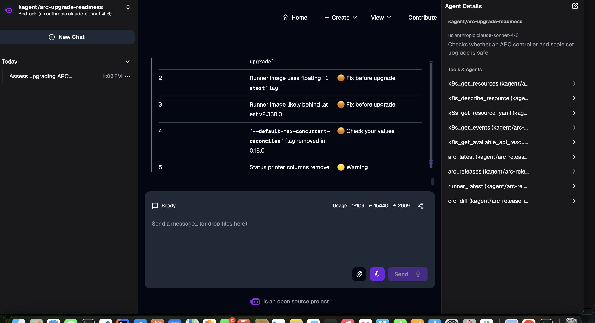

# First run review



**Prompt:** "Assess upgrading ARC from 0.14.2 to the latest gha-runner-scale-set release."
**Model:** `us.anthropic.claude-sonnet-4-6` · **Usage:** 18,109 tokens for the report (31,468 including a markdown re-render) · **Tool time:** ~12 s
**Full report:** [reports/2026-10-12-arc-0.14.2-to-0.15.0.md](../reports/2026-10-12-arc-0.14.2-to-0.15.0.md)

**Bottom line:** the analysis is good, the commands are not. The verdict, CRD finding, release-note summary and timing are right. Three of the generated commands would fail or break the scale set, and two findings are guesses.

## What the agent did (from [logs/13](../logs/13-agent-first-run-tool-calls.log))

| Time (UTC) | Tool | Args |
| --- | --- | --- |
| 06:03:17 | `k8s_get_resources` | AutoscalingRunnerSet, all namespaces |
| 06:03:17 | `k8s_get_resources` | deployment, all namespaces |
| 06:03:17 | `arc_latest` | → resolved target **0.15.0** |
| 06:03:22 | `k8s_get_resources` | EphemeralRunner, all namespaces |
| 06:03:22 | `k8s_get_resource_yaml` | deployment `arc-systems/arc-gha-rs-controller` |
| 06:03:22 | `k8s_get_resource_yaml` | AutoscalingRunnerSet `arc-runners/arc-runner-set` |
| 06:03:22 | `arc_releases` | installed 0.14.2, target 0.15.0 |
| 06:03:22 | `crd_diff` | target 0.15.0 (~5 s, Helm chart pull) |
| 06:03:22 | `runner_latest` | – |

Every call was a read. No tool errors.

## Findings vs reality

| # | Agent finding | Severity given | Assessment |
| --- | --- | --- | --- |
| Verdict | NO-GO | – | **Fair.** "No-go" here means "don't run a plain `helm upgrade`", because CRDs must go first. It's a required step, not a defect in the cluster |
| 1 | All 4 CRDs changed, apply before `helm upgrade` | Blocker | **Correct**, straight from `crd_diff`. Caveat: `crd_diff` compares raw schemas, so "changed" can include defaulted fields |
| 2 | Runner image uses floating `latest` | Fix before | **Correct finding, wrong severity.** Pinning is good practice → Warning |
| 3 | Runner image "almost certainly" behind v2.338.0; "chart bundles v2.337.0 internally" | Fix before | **False positive + unsupported claim.** `:latest` is re-pulled for each new runner pod. Nothing in the tool output supports the "bundles v2.337.0" claim |
| 4 | `--default-max-concurrent-reconciles` removed | Fix before | **Unfinished.** It fetched the controller Deployment YAML (06:03:22) but told *you* to check the args. Installed with defaults, so almost certainly not set |
| 5 | Behavioral changes table (in-place reconcile, printer columns, listener restart, metadata validation…) | Warning | **Useful.** Good summary of `arc_releases`; the one-time listener restart is worth knowing |
| 6 | Validate in staging first | Warning | Generic advice; fine |
| 7 | 0 running EphemeralRunners | Good | **Correct** (matches logs/13 and the idle scale set) |
| Inventory | Container mode "Kubernetes (pod-mode)" | – | **Unverified.** Scale set was installed without `containerMode`, so this looks inferred, not read |

## Command problems

| Generated | Problem | Correct |
| --- | --- | --- |
| `oci://…/gha-rs-controller` | Chart doesn't exist. Agent built the path from the short `helm.sh/chart` label (`gha-rs-controller-0.14.2`) | `oci://ghcr.io/actions/actions-runner-controller-charts/gha-runner-scale-set-controller` |
| `oci://…/gha-rs-runner-scale-set` | Chart doesn't exist (label is `gha-rs-0.14.2`) | `oci://ghcr.io/actions/actions-runner-controller-charts/gha-runner-scale-set` |
| `--set template.spec.containers[0].image=…` with `--reuse-values` | `--set` on a list index replaces the list item with one that only has `image`, dropping `name: runner` and `command` → broken runner pods | Values file with the full container spec (`name`, `image`, `command`) |
| `helm show crds … \| kubectl apply -f -` | Large CRDs can exceed the client-side annotation limit | `kubectl apply --server-side -f -` |

Corrected sequence: end of the [report](../reports/2026-10-12-arc-0.14.2-to-0.15.0.md#corrected-upgrade-commands-human-reviewed).

## Prompt fixes

Added to the agent `systemMessage` ([manifest](../manifests/kagent/arc-upgrade-readiness-agent.yaml)):

```
Rules:
- A runner image tagged :latest is current; recommend pinning as a
  Warning, never report it as outdated.
- Only flag a removed flag or values key if it is actually set in the
  controller Deployment args or the scale set spec; otherwise omit it.
- Never use "likely" or "check your values": verify with a tool or
  mark the item unknown.
- Charts are oci://ghcr.io/actions/actions-runner-controller-charts/
  gha-runner-scale-set-controller (controller) and .../gha-runner-scale-set
  (scale sets). Never build chart paths from helm.sh/chart labels.
- Never use --set on list items (e.g. containers[0]); give a values file
  with the full container spec instead.
- Report container mode only if spec.template or containerMode shows it;
  otherwise say "default (not set)".
- Only state facts that appear in tool output.
```

## Next

1. `kubectl apply -f manifests/kagent/arc-upgrade-readiness-agent.yaml` and re-run the same prompt.
2. Check: findings 3 and 4 gone or verified, correct chart paths, values-file pinning, container mode "default (not set)".
3. Run the corrected upgrade in this sandbox to validate the sequence end to end.
