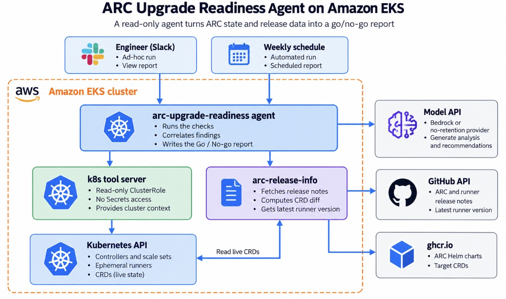
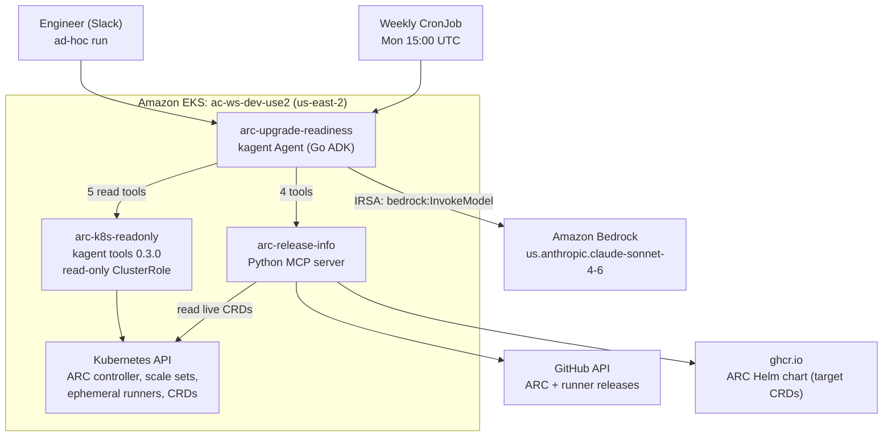
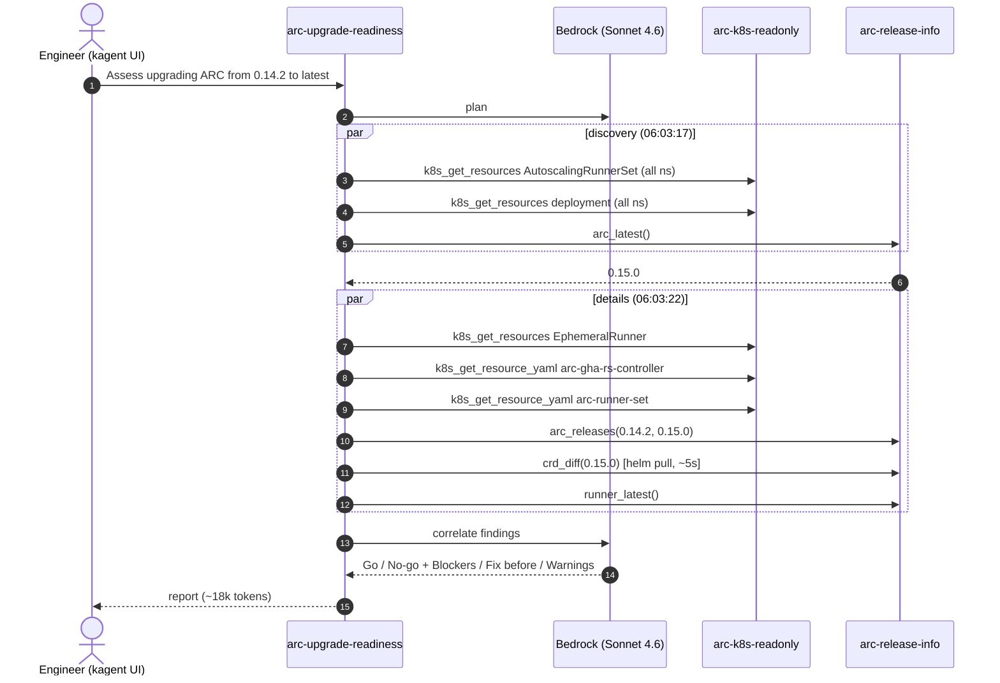

# Flows

All diagrams are Mermaid and render on GitHub. The polished architecture images are in [`../images`](../images).

## 1. Architecture





## 2. One readiness run (as logged in `logs/13`)



## 3. Setup path we actually took

```mermaid
flowchart TD
    s0["Check cluster<br/>logs 01-02"] --> q1{"ARC installed?"}
    q1 -- no --> app["Create GitHub App<br/>ac-ws-arc-runners-dev"]
    app --> perm["Personal account:<br/>repo Administration RW"]
    perm --> arc["Install ARC 0.14.2<br/>controller + scale set"]
    arc --> e403["403 Resource not accessible<br/>logs 03"]
    e403 -->|"retry after perms applied"| runner["Test job runs on<br/>ephemeral runner (logs 04)"]
    runner --> kag["Install kagent 0.10.3"]
    kag --> crash["Controller CrashLoop<br/>+ 10 demo agents config error<br/>logs 05-06"]
    crash -->|"wait for Postgres;<br/>overrides file"| clean["5 core pods healthy"]
    clean --> bed{"Bedrock Sonnet 5.5<br/>invokable?"}
    bed -- "AccessDenied<br/>logs 07" --> agree["Accept agreement<br/>(3 regions)"]
    agree -- "still denied" --> s46["Switch to Sonnet 4.6: OK"]
    s46 --> irsa["IAM policy + IRSA SA<br/>+ ModelConfig"]
    irsa --> ro["Read-only tool server<br/>conn refused -> retry OK<br/>logs 08"]
    ro --> img["Build arc-release-info"]
    img --> e404["Helm 404 (placeholder)<br/>logs 09"] --> img2["Rebuild with build-arg"]
    img2 --> emcp["MCP SDK 2.x crash<br/>logs 10"] --> pin["Pin mcp below 2, image 0.1.1<br/>logs 11"]
    pin --> agent["Apply agent: READY<br/>logs 12"]
    agent --> run["First run + review<br/>logs 13"]
    run --> rules["Review full report:<br/>fix chart paths + prompt rules<br/>logs 14"]
    rules --> cronStep["Step 10: CronJob (pending)"]
```



## 4. Error timeline (2026-10-12, America/Phoenix)

```mermaid
timeline
    title Errors hit while building (local time)
    21:52 : ARC 403 Resource not accessible by integration (self-recovered in 21s)
    22:01 : kagent controller CrashLoopBackOff (self-healed)
          : 10 demo agents CreateContainerConfigError
    22:13 : Bedrock AccessDenied for Sonnet 5.5
    22:17 : Still denied after agreements in 3 regions -> Sonnet 4.6
    22:26 : arc-k8s-readonly connection refused (startup race)
    22:35 : Docker build Helm download 404
    22:56 : ModuleNotFoundError mcp.server.fastmcp (SDK 2.x)
    23:13 : First report has a false positive -> prompt rules
    23:51 : Full report reviewed: wrong chart paths, list --set -> more rules
```
